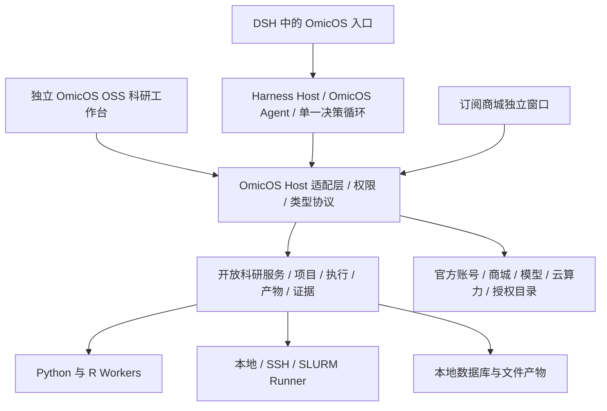
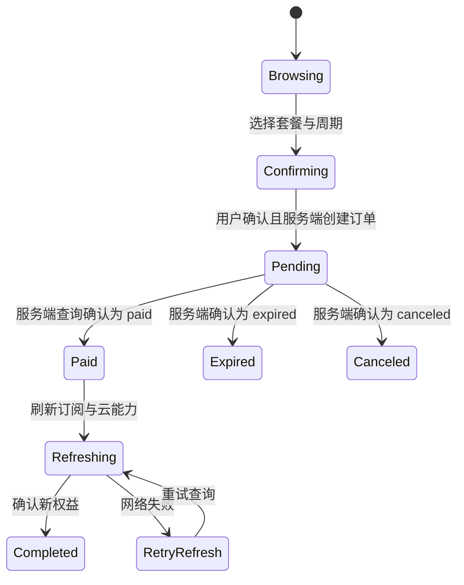

# OmicOS OSS：基于 DeepSeek Harness 的适配重构方案

日期：2026-10-25。状态：迁移设计，正在分阶段实施；已实现与待验收项见 IMPLEMENTATION_STATUS.md。范围包含订阅商城独立窗口。

## 1. 产品目标与开源边界

将 dsh-omicos 从“让 DSH 调用一次完整 Core 对话的插件”升级为“以 Harness 承载 Agent，以开放科研运行时承载 OmicOS 科研能力的开源工作台”。本地分析、自带模型、项目、数据、历史和产物可以独立使用；官方模型、云计算和受授权约束的资源通过 OmicOS 账号接入。商城是正式页面与独立窗口，支持实际购买流程。

“保留 Core 功能”按能力逐项迁移与验收，不意味着第一阶段已经完成全部功能，也不意味着将所有官方服务端公开。最终 OSS 路径必须能从公开源码构建，不能强制依赖私有 Core 二进制。

当前 Core 仓库为私有仓库，未声明开源许可证。下面涉及提取 Core 源码的内容，均属于待完成版权与依赖检查后的发布方案；本设计不授权直接公开现有私有源码。现有 dsh-omicos 为 GPL-3.0-only，不能未经检查改成 MIT。官方付费目录、模型权重、数据库、皮肤和示例数据分别核对再分发许可。

## 2. 核对基线与现有差距

| 对象 | 核对结果 | 对重构的影响 |
| --- | --- | --- |
| dsh-omicos | 0.2.1，提交 3b4d3fcb；Harness peer/dev 基线 0.1.0-rc.6 | 必须适配真实新版 Host 与客户端，不能只改版本号 |
| 插件依赖的 Core | @omicverse/omicos ^0.3.30 | 默认依赖范围不包含当前 0.5.x；连接已有新服务的兼容性需另验 |
| 本地 Core | 0.5.4，提交 0b22cb0d | 以实际源码与注册逻辑盘点，旧 README 不能作为完整现状 |
| Harness | 官方最新预发布 dsh-v0.2.1-rc.3，2026-10-23 发布 | 建议固定该版本建立兼容基线，发布前重新核对；不能盲用 npm latest |
| dsh-scholar | BSD-3-Clause；插件、共享 Research Kernel、独立工作台结构 | 借鉴职责划分；其旧集成基线不能替代本项目的新版验证 |

当前插件只暴露分析、能力查询、变量列表、变量查询、生成文件列表五类工具。已有后台作业、持久 Kernel、会话绑定、活动展示和账号入口，但科研工作台覆盖不完整；ProductsPanel 展示生成文件，不是商品商城。账号页订阅按钮跳转网页，没有内置购买窗口。

当前分析路径为 DSH Agent → Core Agent → 科研工具，存在两个决策循环；默认 full 权限也不能直接作为新版安全与审批设计。活动进度主要存在插件内存缓存中，不能作为持久科研执行记录。

## 3. OmicOS 功能清单与迁移矩阵

以下按用户能力归并。源码存在模块不等于每种平台、权限和部署下均可用；实施时需补充“实际注册条件、输入输出契约、验证用例”明细。阶段编号见第 9 节。

| 能力 | 当前实现证据 | OSS 承载与适配方向 | 阶段 |
| --- | --- | --- | --- |
| 模型与对话 | providers、custom_providers、runtime、turn_hub、history | Harness 承担主 Agent 与模型调用；官方模型接可选云 Provider；保留流式、取消、恢复与模型配置语义 | M1–M2 |
| Agent、领域与 Skill | agents、skills、catalog、tool_providers | OmicOS 专属 Agent 配置、公开 Skill 包与来源清楚的目录；官方授权目录独立接入 | M1–M3 |
| 子 Agent 与任务委派 | delegation_constraints、TeamProvider、session_tasks | 复用经验证的 Harness 委派能力，补科研数据范围、权限与结果契约 | M2 |
| Python/AnnData 持久分析 | kernel、kernel_execution、native、builtin 工具 | 开放科研服务管理 IPython、变量、对象与执行队列；不能每次工具调用新建 Python | M1–M2 |
| R 与环境管理 | r_environments、r_runner、env_bootstrap | 独立语言环境和版本指纹；按需安装、诊断与依赖检查 | M2 |
| 数据导入、浏览、变量与文件操作 | native、workspace_inventory、file_manager、adata_state、kernel_vars | 数据/变量面板与受权限控制的文件工具；支持大文件路径引用 | M1–M2 |
| Notebook 与导出 | notebook_state、notebook_export | 交互单元、执行结果、变量关联、导出；保留项目与固定会话绑定 | M2 |
| 图表、图片、产物与 Figure Studio | figure_studio、figure_result、figure_publisher、figure_review | 产物浏览、预览、版本与审阅；科学原始数据和图像导出可追溯 | M1–M3 |
| 后台科研作业 | background、process_events、progress_route | 任务队列、进度、日志、取消、退出恢复；明确实际执行状态 | M1–M2 |
| 分析计划、待办与人工审批 | plan、todo、approvals、review_guard | 接 Harness 工具审批；科研计划与重计算确认保留独立状态机 | M2 |
| 科研方法和分析质量约束 | skill_lookup、method_version、review_guard、evidence_provenance | 方法版本、对象状态检查、审阅隔离、证据记录；不能仅靠系统提示词 | M2 |
| Pipeline 与运行恢复 | pipelines、resume_journal、pipeline cards | 固定定义/Skill 版本、检查点、人工决策与取消恢复；界面显示运行阶段 | M3 |
| 会话、项目与长期记忆 | session_memory、project_memory、memory_tree、memory_tree_build | 项目事实、摘要、记忆树、提案/确认与整合；与聊天历史分开存储 | M2–M3 |
| 项目资料与科研档案 | project_dossier、workspace_inventory、session_search_local | 项目工作台、检索、资料整理；自动整理必须保留事实来源 | M2–M3 |
| 联网搜索与论文/数据库工具 | web、bio_relay、omim、target_atlas、mineru、paper2agent | 工具适配与可选服务连接；数据许可、密钥、离线包逐项区分 | M2–M3 |
| MCP 与 A2A | mcp、tool_providers、agent card 路由 | 优先复用 Harness 已验证支持；补 OmicOS 目录、连接诊断、服务权限 | M3 |
| SSH、远端 Kernel 与集群 | connections、native_ssh、ssh_config、slurm | Runner Profile 统一描述本地/SSH/调度器，保留 MFA、日志和故障恢复 | M3 |
| 云算力与官方中继 | cloud_compute、cloud_auth、llm_relay、netrelay、bio_relay | 官方服务适配器与用量展示；云端授权、作业状态以服务端为准 | M3 |
| 定时任务、目标与自动运行 | goals、goal_templates、schedule、task | 可恢复任务记录与触发器；先核实 Harness 基线支持，再决定复用或适配 | M3 |
| 渠道、连接与扩展 | claws、connections、workspace_extensions、plugins | 可选扩展模块；渠道凭据与用户数据按连接隔离 | M4 |
| 轨迹、回放、审计与诊断 | trajectory、replay_export、usage_audit、diagnostics、log_buffer | 脱敏导出、操作审计、失败诊断、科学步骤回放 | M2–M4 |
| 安装、更新与存储迁移 | updater、local_state、storage、legacy_store_discovery、cache_crypto | 运行时按需下载、协议协商、数据迁移与回滚；不依赖桌面壳升级 | M1–M4 |
| 账号、套餐、订单与权益 | UI billing.ts、Core auth_plan、云端 subscriptions | 独立商城窗口与云账号适配器，完整保留购买与订阅管理能力 | M1、M3 |
| 桌宠、原生窗口、托盘与系统交互 | 属于 OmicOS UI/桌面壳，非纯 Core | 通过可选桌面桥接插件复用；普通浏览器明确提示不支持的系统动作 | M4 |

### 已知边界，不能计作完成能力

- Pipeline 文档中的 Nextflow 执行器、部分验证包仍属于未实现规划，不能列为已有功能并承诺迁移完成。
- Target Atlas 的客户端读取与缓存能力，不等于其数据构建管线和所有数据可自由再分发。
- 后台任务当前有 POSIX fork 与内存继承语义；Windows、容器与 SSH 不能悄悄换成空进程后声称等价。需显式声明能力，必要时使用有清单的对象快照/文件输入。
- 证据追踪有覆盖范围，未知 I/O 要标记未知，不能把模型总结等同于已验证事实。

## 4. 推荐架构

### 组件职责

1. **Harness Host**：保留原生插件生态与会话/模型机制；加载 OmicOS Agent、领域规则与科研工具。主分析使用一个决策循环。独立工作台连接同一 Host 的 Agent 服务，不启动另一套隐蔽 Core Agent。
2. **Host 适配层（TypeScript）**：收拢 Cordis 生命周期、工具定义、槽位、授权、窗口请求、流式进度和云端请求。客户端不持有支付、模型或云账号秘密。新版 Remote/槽位接口以实际公开 API 为准，不能仅因内部存在同名机制就认为第三方可调用。
3. **开放科研服务**：优先提取可发布的现有 Rust 科研实现，维持 Python/R Worker；负责项目、环境、Kernel、作业、Notebook、产物、证据、科学工作流。避免为换平台完整重写成熟科研逻辑。无权公开的部分须给出公开实现或插件接口，不能强制回退私有二进制。
4. **工作台**：DSH 内提供轻入口与进度，独立页面承载数据、变量、Notebook、图表、Pipeline、记忆、任务与设置。参考 Scholar 的共享内核方式，不复制数据，也不把整套工作台塞成聊天气泡。
5. **官方云适配器**：账号、目录、权益、模型、算力、订阅与订单。未接官方云时，本地科学运行正常；认证失败和网络失败不能伪装成“必须升级套餐”。
6. **旧 Core 兼容后端**：作为迁移期可选模式保留，用于差异对照和高级功能过渡。界面明确显示当前后端与缺失能力，最终 OSS 验收不能依赖它。

### 数据归属与协议

- Harness 是聊天记录、模型工具请求和 Agent 会话的权威来源。
- 科研服务是项目、Kernel、单元执行、任务、检查点、产物、证据和科研记忆的权威来源。
- 官方服务端是账号、订单、支付结果与权益的权威来源。
- 使用明确的 project_id、session_binding、kernel_id、invocation_id、job_id、artifact_id 关联；同一请求重试需查询既有执行，不能重复运行昂贵分析。
- 本地使用带迁移版本的 SQLite 保存元数据与执行事件，数据集和大型产物使用文件及内容哈希。科学事件持久化后再投影到 UI；禁止第三方插件调用 Harness 仅供内部实验插件使用的 appendPluginRecord。
- Kernel 身份至少区分项目、执行目标、语言、环境；每个 Kernel 串行执行。聊天切换不清空对象，不同项目不能误共享数据。审阅需隔离；Python 只读变量名本身不构成强安全边界。
- 控制面使用受认证的本机 IPC/loopback，支持协议版本与能力发现、事件序号、重连和终态查询。跨机器走显式 Runner，不能将本机管理端口裸露到网络。
- 安装包只带轻量入口；科研运行时、环境与工具包按需下载，校验完整性并保留可回退版本。协议不兼容时明确报错，不自动改用更高权限模式。

## 5. 订阅商城窗口：纳入正式产品范围

### 入口和页面

DSH 的 OmicOS 页面、独立工作台导航、账号设置均可打开商城；能力因权益受限时展示原因与“查看套餐”。采用独立路由和可单独打开的窗口，复用相同账号与订单服务。商城自身包含选购、二维码、订单和订阅状态，而非只跳转官网或 iframe 嵌套现有站点。

首期必须包括：登录/退出、套餐与周期选择、服务域选择、服务端价格、订单确认、微信/支付宝付款二维码、订单状态、当前订阅、权益刷新、续订入口、错误和过期处理。后续补齐实验室席位、订单历史、发票、到期提醒及取消/恢复订阅管理。官方云算力与额度也放入商城/云服务导航，其商品化接口需单独核对，不能假定所有云资源都通过套餐 checkout 销售。

现有前端使用 Vue；DSH 客户端为 React。应提取类型、请求适配与状态逻辑，再实现当前 Host 的组件，不能直接搬 Vue 组件进 React。优先解决认证分区和支付链接限制，不以第三方页面 iframe 作为唯一支付方案。

### 已核对的复用接口

来源：omicOS-ui/src/services/billing.ts。路径为当前实现事实，不构成新服务端协议已完成的声明。

| 操作 | 接口 |
| --- | --- |
| 套餐目录 | GET /api/plans?domain=... |
| 创建订单 | POST /api/billing/checkout |
| 查询支付 | GET /api/billing/orders/{order_no} |
| 当前/各域订阅 | GET /api/billing/subscription；GET /api/billing/subscriptions |
| 实验室价格与席位 | GET /api/billing/lab/pricing；POST /api/billing/lab/{id}/seats |
| 到期提醒 | GET /api/billing/expiry-reminders |
| 取消/恢复订阅 | POST /api/billing/subscription/cancel；POST /api/billing/subscription/uncancel |
| 发票 | GET /api/billing/invoicing；POST /api/billing/invoicing/invoices；POST 对应 invoice_id/withdraw |

checkout 当前包含 plan_code、period、provider，可选 domain、seats、lab_id、lab_name；返回 order_no、金额、币种、pay_url 与到期信息。价格、折扣、可购买资格、席位数量约束和订阅有效期由服务端计算，不在客户端写死。当前账单客户端已归并官方云入口，不能按过时注释重建地域路由。

### 支付和权益状态机

订单确认页展示真实价格与周期；用户主动确认后才创建订单。Host 查询订单并向窗口发送状态，关闭窗口停止轮询但不擅自取消订单。需要跳官方浏览器支付时，窗口保留订单并能回来查询。

支付成功依据支付渠道回调及服务端订单状态；前端二维码扫描、跳回页面或计时结束均不能自行激活权益。付款后刷新账号权益与相关服务目录；不自动重新执行之前失败的收费模型请求或昂贵计算任务。

Harness 的模型账号与 OmicOS 云账号独立。切换用户后销毁旧账号订单订阅监听；迟到响应不能覆盖新账号。Host 保管凭据并脱敏，窗口不从 URL 或 localStorage 读取长期令牌。支付依赖服务端用户与订单归属校验，不能只靠隐藏按钮。生产版禁止暴露 mock 支付接口。

Agent 可以查询套餐、解释权限、打开商城；购买、取消订阅等敏感变更由用户在窗口内明确操作，不提供可自动支付的 Agent 工具。网络/认证/权益未知分别展示，不用“升级套餐”覆盖所有失败。订阅到期保留本地数据、历史、Kernel 和 BYOK，限制由官方服务验证的云端操作。

## 6. Harness 适配工作

1. 固定包版本与运行版本基线，集中管理，检查 npm dist-tag 与各包对齐；接入真实 Host 冷启动验证。
2. Host 与 Client 各设一层兼容边界，去除业务代码直接访问旧会话内部结构、旧槽位与旧工具视图接口。
3. 生命周期涵盖工具、路由、订阅、窗口和后台任务；热重载不重复注册、不误杀非本插件启动的服务。
4. 建立能力发现，涵盖审批、后台任务、会话恢复、图像产物、原生窗口、远程 Runner；不支持时给出明确状态。
5. 审批接入当前正式工具执行机制，取消传递到远程作业并确认真实终态；不因审批接不上而默认 full。
6. 实测图像结果、产物展示与多模态适配。旧插件“图只能放 presentationMeta”的限制需重新验证，不能当作新版永久限制。
7. 把内存活动缓存降为 UI 优化；运行进度和结果能从科研服务恢复，聊天历史不承载非公开自定义日志记录。
8. 保留旧项目/会话映射的显式迁移；提供迁移报告和回滚，不自动向云端同步科研数据。

## 7. 架构决策记录（ADR）

### ADR-001：Harness 单一 Agent + 共享开放科研服务

决策：推荐该方案。保留成熟科研代码，替换旧插件双 Agent 默认链路。

对比：仅升级旧插件最快，但私有二进制依赖和覆盖不足仍在；整体公开 Core 并继续让其主导对话可以减少初期行为差异，但开源拆分范围更大，也会保留两套会话/模型机制；全部重写为 TS/Python 则增加科研语义回归风险。

代价：需要逐项分离 Rust 科研逻辑与私有云目录、模型循环、授权代码；不能用一次大版本替换完成。先用最小分析闭环证明可拆分，再扩展。

### ADR-002：商城使用独立页面，通过 Host 接官方账单接口

决策：共享账号和请求模型，重建适合 Harness 客户端的界面；官方服务继续管理交易与权益。

对比：官网链接成本低但不满足窗口内购买；iframe 会受认证与支付平台限制；自行实现支付后台会扩大合规、对账与运维范围，且已有接口可复用。

代价：需要维护客户端窗口状态、跨窗口账号变更和订单恢复。通过共享状态协议与服务端权威状态减小重复逻辑。

### ADR-003：按能力包迁移，兼容后端仅为过渡

决策：所有能力分配阶段与验收条件；旧 Core 可选运行，开源安装路径单独验收。

代价：迁移期存在两个后端的适配与差异维护成本。每完成一个能力包，缩小兼容路径依赖，避免无限延长过渡。

### ADR-004：执行记录独立持久化，聊天仅作关联与展示

决策：科学任务与产物以科研服务为权威，Host 保持聊天会话权威；使用显式标识关联。

代价：需要处理跨边界重试与事件投影，不承诺网络“恰好一次”。通过幂等执行标识、状态查询、重连去重和可审计终态避免重复分析。

## 8. 非功能要求与故障处理

| 要求/故障 | 设计与验收方向 |
| --- | --- |
| 可独立构建 | 干净机器仅靠公开源码与公开依赖完成本地科学闭环；无私有 Core 或官方账号依赖 |
| 科研对象保真 | 连续多轮使用同一 AnnData，变量、图、Notebook 与数据状态一致；禁止隐式重置、重复 log 转换 |
| 性能与内存 | 传数据引用而非聊天传大型对象；记录资源与进度；后台 fork 的 BLAS 线程语义须保留并实测 |
| Host/窗口崩溃 | 重开后恢复任务和产物，确认作业真实状态；浏览窗口关闭不默认中止后台分析 |
| 网络断线/重复请求 | 事件序号去重、结果补查、稳定 operation ID；未知执行结果先查后重试 |
| 取消与审批 | 拒绝后无实际副作用；取消确认来自执行端；不静默升级权限 |
| 证据和审阅 | 记录输入数据、方法、代码与产物来源；未知证据显示未知；审阅不能改写主分析对象 |
| 云端不可用 | 本地路径可用；登录错误、网络错误、权益不足分别表达 |
| 订单竞态 | 服务端终态优先；支付成功后查询失败不回退未支付；切账号不串单 |
| 更新与迁移 | 协议协商、校验、数据备份、兼容读取和回滚；不把数据库升级绑到桌面壳升级 |
| 扩展与秘密 | 插件权限显式化；Host 保管秘密；不自动上传私有数据、完整日志或模型密钥 |

## 9. 分阶段交付与完成定义

### M0：基线、开源清单与契约

- 建立 Core 能力登记表、实际注册条件和依赖/版权清单；确定可公开组件与替代项。
- 固定 Harness rc.3 基线并用真实 Host 验证工具、槽位、生命周期、审批和会话接口。
- 定义协议、数据归属、Kernel 身份、旧会话迁移与 capability discovery。

完成条件：不存在“靠私有二进制才能构建”的隐藏默认依赖；提取范围有明确许可依据。

### M1：可运行的 OSS 纵向闭环，包含商城

- 专属 OmicOS Agent → 科研工具 → 持久 Python → 数据/变量 → 图与产物 → 历史恢复。
- DSH 入口和独立科研工作台，共享项目与科学运行服务。
- 官方云登录、套餐目录、用户确认下单、支付二维码、订单查询、订阅与权益刷新独立窗口。
- 按需下载科研运行时与依赖，支持无官方账号的 BYOK 本地闭环。

完成条件：干净安装可重复完成上述流程；商城真实接通测试环境并验证取消、过期、断线和账号切换；不进行未经用户授权的真实扣款。

### M2：科研日常能力与质量对齐

补齐 R、Notebook、环境、后台任务、Agent 委派、计划审批、科研 Skill、项目/会话记忆、证据和隔离审阅；建立与现有 Core 同输入的行为对照用例。

完成条件：对象连续性、取消、恢复、环境身份和分析产物对齐通过；重计算不会被模型误触发为无提示操作。

### M3：高级科研与云服务对齐

补齐 Pipeline、记忆树、档案整理、Target Atlas/论文数据库连接、MCP/A2A、SSH/SLURM/云算力、目标与定时任务；商城补齐席位、发票与订阅管理。逐项核对云算力商品接口与数据资源许可。

完成条件：能力表每项有可运行证据，或明确记录上游尚未实现/外部资源授权条件；远端作业和支付恢复有集成验证。

### M4：生态、桌面桥接与发布收口

补齐渠道、可选桌宠和系统交互、审计回放、旧数据迁移与公开安装文档。按平台列出真实支持矩阵，确保轻入口与能力包可独立更新。

完成条件：不再以“后续再做”代替已承诺的功能清单；发布说明区分完成、条件支持与上游未实现能力。

## 10. 验证与建议拆分

实现建议按可审查 PR 拆分：Harness 基线 → 协议与科研服务抽取 → Python/产物闭环 → 工作台 → 账号/商城窗口 → 日常科研 → 高级科研/远程 → 迁移与发布。商城在 M1 交付，不能延期成最后一个外链按钮。

测试以真实边界为主：真实 Host 插件冷启动、带 AnnData 的多轮执行、进程重启恢复、长任务取消、审批拒绝、对象隔离、云接口契约、支付沙箱、账户切换、开源干净安装。纯模拟单测不能证明新版 Harness 兼容、科研结果等价或支付实际成功。

当前仅完成源码盘点和设计；没有更改运行时代码，没有实施支付，没有宣称全功能迁移完成。

## 11. 核查来源

- [dsh-omicos](https://github.com/omicverse/dsh-omicos)：本地 README、package.json、src/host 与 src/client；当前五类工具、Core 依赖、账号页与产物面板。
- [Harness rc.3 发布](https://github.com/deepseek-ai/deepseek-harness/releases/tag/dsh-v0.2.1-rc.3)：版本基线；接口另外核对该标签下 packages/core、api/remotes、client/ui-slots 的源码与文档。
- [Harness 会话契约](https://github.com/deepseek-ai/deepseek-harness/blob/dsh-v0.2.1-rc.3/packages/core/session/README.md)：插件记录接口对外部插件的限制。
- [dsh-scholar](https://github.com/lzszq/dsh-scholar)：仅借鉴共享科研内核与独立工作台；[其集成文档](https://github.com/lzszq/dsh-scholar/blob/main/docs/dsh-integration.md) 的旧版本基线不能证明本项目兼容新版。
- 私有本地 Core：Cargo.toml、src/lib.rs、server.rs、tool_providers、plugins、kernel、native、pipelines、memory、review_guard、evidence_provenance 等。本设计仅归纳能力，不复制私有源码。
- 本地 UI：src/services/billing.ts、BenchSubscription.vue、PaymentDialog.vue、usePaymentDialog.ts 与账号/云请求模块；服务端 subscriptions.py 用于核对支付激活链路。
